# Techniek 03 — Elektrische schema's lezen

Module: Techniek (Techniekbasis) · Les 3 van 7 · Bron: ACS Academy (Climatics cursus), gelezen 27-10-2026 · Status: samenvatting in eigen woorden (zonder praktijkopdracht, zelftoets en toets)
Voorkennis: Techniek 01, 02
Volgende les: Techniek 04 — Basis regeltechniek

Trefwoorden: afbeeldingen, voorbeeldschema, blad 8, voedingsblad, Intesis, SL2000, UR20, kruisverwijzing, klemconventie, hoofdstroom, stuurstroom, klemmenschema, klemmenlijst, kenletters IEC 81346, IEC 60617, contactspiegel, maakcontact, verbreekcontact, relais, spoelspanning, fasebewaking, motorbeveiligingsschakelaar, magneetschakelaar, hand-0-auto, I/O-blad, procescode, RTD, potentiaalvrij, kopstation
Beantwoordt vragen als: Hoe lees ik een stuurstroomschema? Wat betekent -K1, -B4, -Q1, -X? Waarom geen relais als motorbeveiliging? Hoe volg ik een signaal van voeler naar Climatics? Waar zoek ik bij een storing in de stuurstroomketen?

---

- Tekeningsoorten: P&ID/installatieschema (wat zit erin; ook de basis van het Climatics-schema), blok-/eendraadschema (globaal, overleg met klant: 230/400 V en ampère), hoofdstroom, stuurstroom, aansluit-/klemmenschema, klemmenlijst, opstellingstekening. Controleer altijd titelblok, revisie en datum. Codering langs de rand (cijfers/letters) geeft een adres op het blad.
- Contactspiegel onder een spoel toont waar de contacten staan en of ze maken of verbreken. Fasebewaking bewaakt uitval, volgorde en uitlopen van fasen.
- Kenletters IEC 81346: A regelaar/PLC, B opnemer/sensor, F beveiliging, K schakelend orgaan/relais, M motor, P signaal/lamp, Q vermogensschakelaar, S bedienend orgaan, T trafo, U omvormer/voeding, X klem. Symbolen IEC 60617.
- Faalveilig: veiligheden zijn verbreekcontacten in serie vóór de spoel (noodstop bovenin, thermisch contact motor, enz.).
- Relais: vermogen, scheiding, meerdere functies. Spoelspanning moet kloppen (24 V DC, 24 V AC of 230 V AC). Spanning op A1/A2 en geen aantrekken = spoel of mechaniek stuk; geen spanning = open voorwaarde hoger in de keten.
- Motorgroep: motorbeveiligingsschakelaar (thermisch op nominale typeplaatstroom, magnetisch tegen kortsluiting), magneetschakelaar, frequentieregelaar, werkschakelaar bij de motor (hier hangt de monteur zijn slot, vaak met vooruitlopend hulpcontact bij omvormer), hand-0-auto-schakelaar (staat iets onverklaarbaar aan of uit: eerst deze stand controleren), vrijgave van regelaar (grens elektro/regeltechniek), meldlamp via hulpcontact.
- Pomp met ingebouwde omvormer: alleen automaat + hulpcontact + werkschakelaar in de kast. Oudere pomp zonder elektronica: motorbeveiligingsschakelaar. Een relais is geen motorbeveiliging (aanloopstroom, boog bij uitschakelen). Eenfasige pomp krijgt vaak driepolige MBS, stroom door twee thermische elementen volgens fabrikant.
- Storingzoeken: stuurstroomketen van boven naar beneden meten; eerste punt met spanning aan de ene en niet aan de andere kant is de open voorwaarde.
- I/O-bladen: per kanaal functie, procescode (bijv. RK1.13TT1), kanaal en klemmen op de kaart, klem op strook, veldapparaat. Procescode is de rode draad door I/O-blad, klemmenlijst en Climatics: begin bij een verdacht getal altijd bij de code. Volgorde van kaarten op de rail bepaalt de adressen. Relaisuitgangen zijn potentiaalvrij. Analoge uitgang heeft SENSE+/- voor spanning aan het kabeluiteinde. Busapparatuur via gateway (DATA−/DATA+ noteren).

## Afbeeldingen en schema's (door Jasper aangeleverd, 27-10-2026)

Let op: dit zijn voorbeeldtekeningen uit de cursus (ACS-schema's, o.a. projecten LdH Kreekpad nr. 1478 en LDH Kooikerweg RK1). Beschrijving in eigen woorden; waar de tekening twijfelachtig is, staat dat erbij. De interactieve ventilatorgroep-tekening (Techniek 03) is nog niet verwerkt.

Algemeen bladformaat: raster met 17 kolommen (1–17) en 8 rijen (A–H). Een adres als "9-C2" = blad 9, vak C2. Pijlen (driehoekjes) aan de rand verwijzen naar het volgende of vorige blad: bijv. "6-H5 24VDC → 11-G2" betekent dat de 24 VDC-lijn van blad 6 (vak H5) komt en doorloopt naar blad 11 (vak G2). Titelblok onderaan: status, tekenaar/author, revisie, datum, projectnummer, blad x/y. Kleuren in de ACS-bladen: rood = +24 VDC, grijs = 0 V, groen = analoog signaal, paars gestippeld = databus (Modbus), oranje = 24 VAC, bruin = 230 V, blauw = nulleider N1.

### 1. Hoofdstroom (blad 8/38, "hoofdstroom")

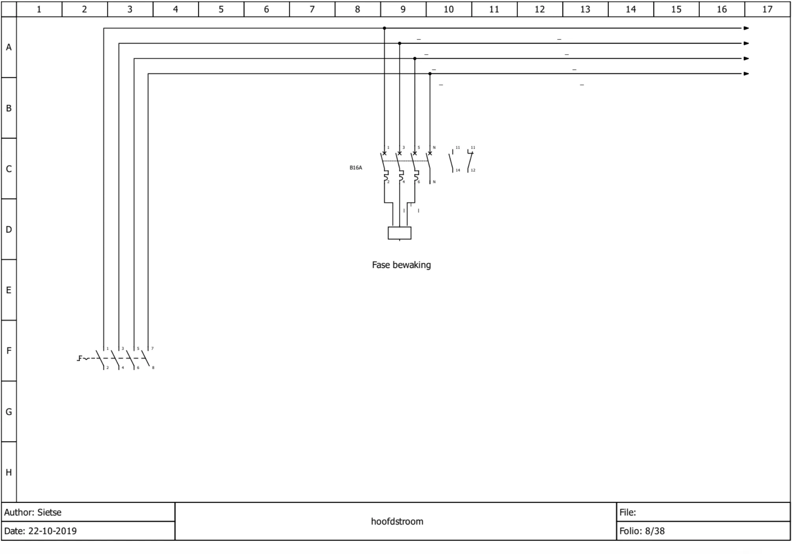
- Vier lijnen bovenin (L1, L2, L3, N) lopen als pijl naar rechts door naar de volgende bladen.
- Linksonder: viervoudige hoofd-/werkschakelaar (klemmen 1-2, 3-4, 5-6, 7-8; met handbediend schakelsymbool).
- In het midden: driepolige automaat B16A (klemmen 1/2, 3/4, 5/6 plus N) met twee hulpcontacten ernaast: maakcontact 11-14 en verbreekcontact 11-12. Daaronder het kader "Fase bewaking" (fasebewakingsrelais op L1/L2/L3).
- Les: hoofdstroom begint met de hoofdschakelaar, dan beveiliging, dan de verbruikers. Hulpcontacten van de automaat geven de stand/uitval door aan de stuurstroom.

### 2. Voedingsblad (stuurstroom en voedingen)

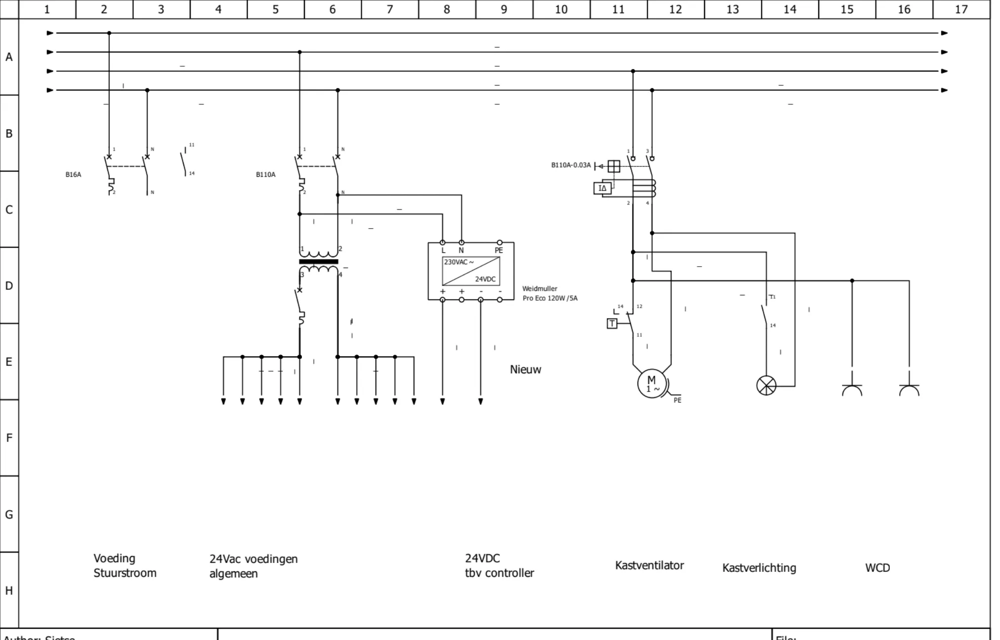
Van links naar rechts, onder de vier doorlopende lijnen:
- "Voeding stuurstroom": 1P+N automaat B16A met hulpcontact 11-14.
- "24Vac voedingen algemeen": automaat (op de tekening "B110A", waarschijnlijk B10A bedoeld, controleer op de echte tekening) gevolgd door een scheidingstransformator 230→24 VAC (primair klem 1-2, secundair klem 3-4, secundair beveiligd met een eigen automaat). Secundaire 24 VAC-lijnen lopen via pijlen naar de bladen waar ze nodig zijn.
- "24VDC tbv controller": Weidmüller Pro Eco 120 W / 5 A voeding, 230 VAC → 24 VDC. Ingang L, N, PE; uitgang +, +, −, −. Op de tekening gemarkeerd als "Nieuw".
- "Kastventilator": aardlekautomaat (B10A met 30 mA, op de tekening "B110A-0.03A", symbool IΔ) → thermostaatcontact T (klem 11/12/14) → motor M 1~ met PE.
- "Kastverlichting": lamp achter een schakelcontact (deurschakelaar).
- "WCD": twee wandcontactdozen (stopcontacten voor in de kast).
- Les: één blad toont de hele energieverdeling in de kast. 24 VAC (voor kleppen/relais) en 24 VDC (voor controller en I/O-kaarten) komen uit twee aparte voedingen. De kastventilator wordt thermostatisch ingeschakeld. Nulleider van de aardlekautomaat niet over andere groepen mengen.

### 3. Pomp met ingebouwde elektronica (modern), blad "28TP1"

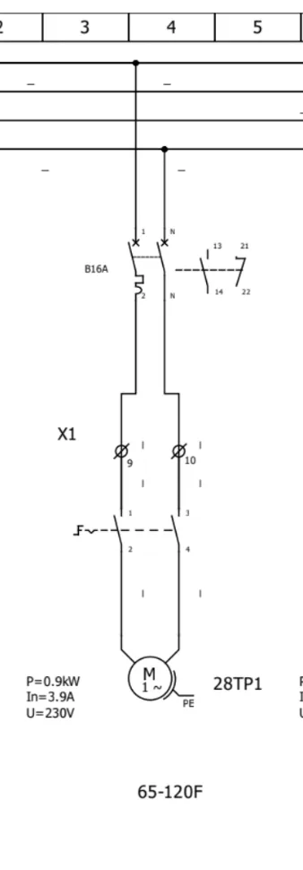
- Automaat B16A 1P+N met twee hulpcontacten (13-14 maak, 21-22 verbreek), via klemmenstrook X1 (klem 9 en 10) naar de werkschakelaar (klemmen 1-2 en 3-4, handbediend) en de pomp (M 1~, PE).
- Gegevens naast de motor: P = 0,9 kW, In = 3,9 A, U = 230 V. Pomp 28TP1, type 65-120F.
- Les: bij een pomp met ingebouwde omvormer volstaan automaat, hulpcontact en werkschakelaar in de kast; de pomp beveiligt zichzelf.

### 4. Pomp zonder elektronica (oud), sjabloonblad

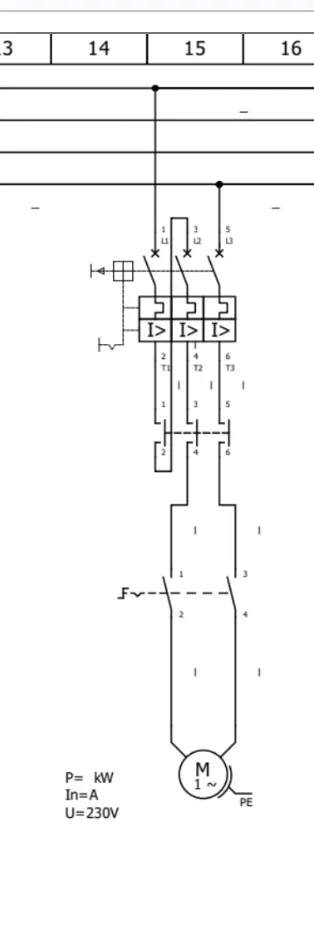
- Driepolige motorbeveiligingsschakelaar (I> in elke pool, klemmen L1/T1, L2/T2, L3/T3, met hulpcontact links) → magneetschakelaar (hoofdcontacten 1-2, 3-4, 5-6) → werkschakelaar (1-2, 3-4) → motor M 1~ met PE.
- Typeplaat-regels zijn leeg ("P= kW, In= A, U=230V"): sjabloon om in te vullen.
- Les: bij oudere pompen zit de beveiliging in de kast. Eenfasige motor via driepolige motorbeveiligingsschakelaar is gebruikelijk (stroomlus door twee thermische elementen volgens fabrikant).

### 5. Kopgroep Weidmüller SL2000 (blad 10/20, project LdH Kreekpad)

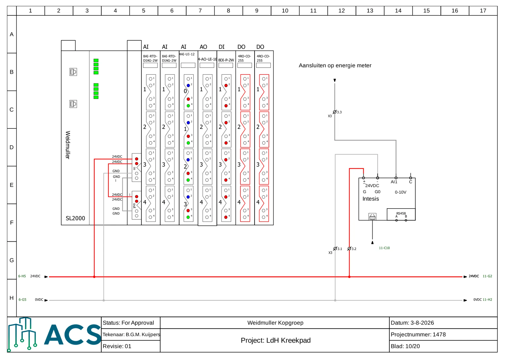
- Links de SL2000-kop met twee ethernetpoorten en status-LED's; rechts van de kop de kaarten op volgorde: AI (8AI-RTD-DIAG-2W) ×2, AI (4AI-UI-12), AO (4-AO-UI-16), DI (8DI-P-2W), DO (4RO-CO-255) ×2. Per kaart vier aansluitblokken, genummerd 1 t/m 4 (op de 4AI-kaart 0 t/m 3).
- De DO-kaarten zijn rood omlijnd (relaisuitgangen, andere spanningsgroep dan de rest).
- Voedingsklemmen van de kop (in/out) krijgen 24 VDC (rood) en GND (grijs) vanaf de 24 VDC / 0 VDC-lijnen onderaan (6-H5 en 6-G5; doorgang naar 11-G2 en 11-H2).
- Rechts: Intesis-gateway (24 VDC via klemmen X3.2 plus, X3.1 min; ingang AI1 0-10 V via X3.3 voor de energiemeter, RS485 A/B, ethernet naar 11-C10). Tekst: "Aansluiten op energie meter".
- Les: de volgorde van de kaarten op de rail bepaalt de adressen. Elke kaart is op de tekening zichtbaar met zijn type, zodat klemmen en kanaalnummers aan de echte kaart kunnen worden gekoppeld.

### 6. Kopkaart Modbus (blad 12/20, twee gateways)

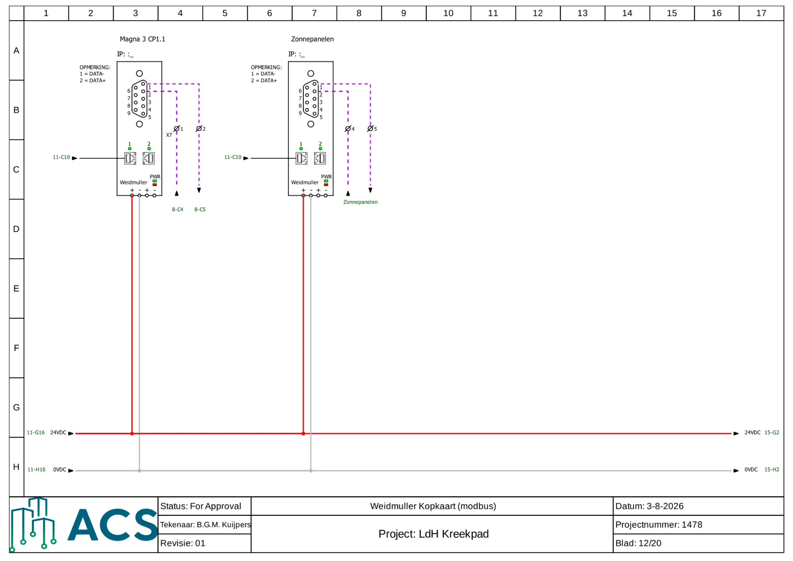
- Twee Weidmüller gateways: "Magna 3 CP1.1" (pomp) en "Zonnepanelen". Elk heeft een DB9-connector (pin 1 en 2 worden gebruikt), twee ethernetpoorten (naar 11-C10), PWR-LED en 24 VDC-aansluiting (+ rood, − grijs).
- Opmerking op de tekening: pin 1 = DATA−, pin 2 = DATA+. De bus loopt als paars gestippelde lijn via klemmen X7.1/X7.2 (Magna) en X7.4/X7.5 (zonnepanelen) naar het apparaat (8-C4/8-C5 respectievelijk "Zonnepanelen").
- Les: noteer altijd welke pin DATA+ en DATA− is; verwisselde polariteit is een klassieke oorzaak van "geen communicatie". IP-adres staat open ("IP: :_") en wordt tijdens inbedrijfstelling ingevuld.

### 7. Analoge ingangen RTD (blad 13/20, UR20-8AI-RTD-DIAG-2W)

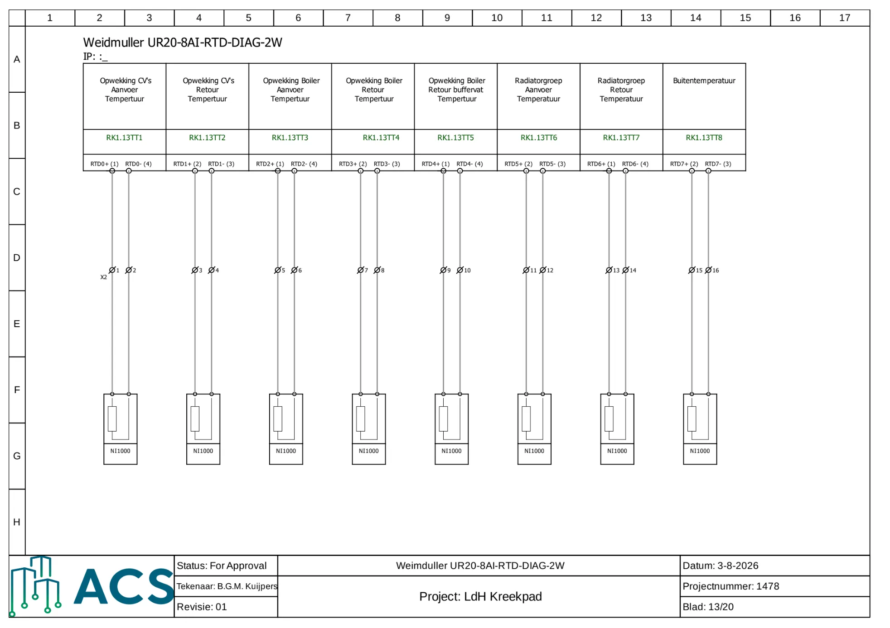
- Acht Ni1000-voelers, tweedraads, elk met eigen procescode (RK1.13TT1 t/m TT8): CV-opwekking aanvoer en retour, boiler aanvoer en retour, retour buffervat, radiatorgroep aanvoer en retour, buitentemperatuur.
- Klemmen X2.1 t/m X2.16 (twee per voeler); kaartklemmen RTDn+ en RTDn− (met kaartpinnummers 1 t/m 4 afwisselend).
- Les: dit is het basisvoorbeeld van een I/O-blad: functie, procescode, kanaal, klem op strook, veldapparaat. Bij twee-draads Ni1000 telt kabelweerstand mee in de meting.

### 8. Analoge ingang UI (blad 15/20, UR20-4AI-UI-16)

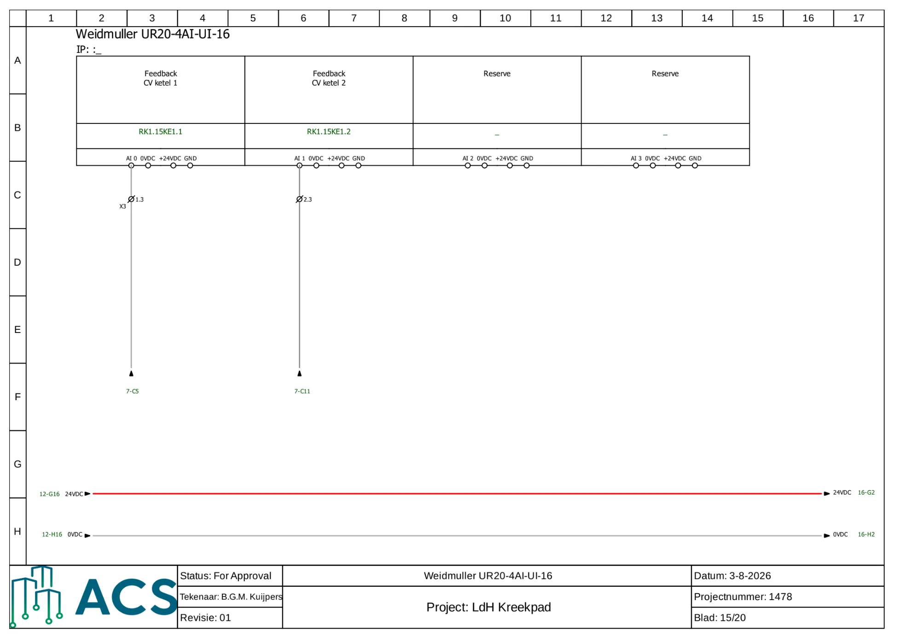
- Kanaal 0: feedback CV-ketel 1 (RK1.15KE1.1) via klem X3 "1.3". Kanaal 1: feedback CV-ketel 2 (RK1.15KE1.2) via X3 "2.3". Kanaal 2 en 3: reserve.
- Elk kanaal heeft vier klemmen: AI n, 0 VDC, +24 VDC, GND. De signaalverwijzing gaat naar blad 7 (7-C5, 7-C11).
- Les: let op de klemconventie hieronder.

### 9. Analoge uitgang (blad 16/20, UR20-2AO-UI-16)

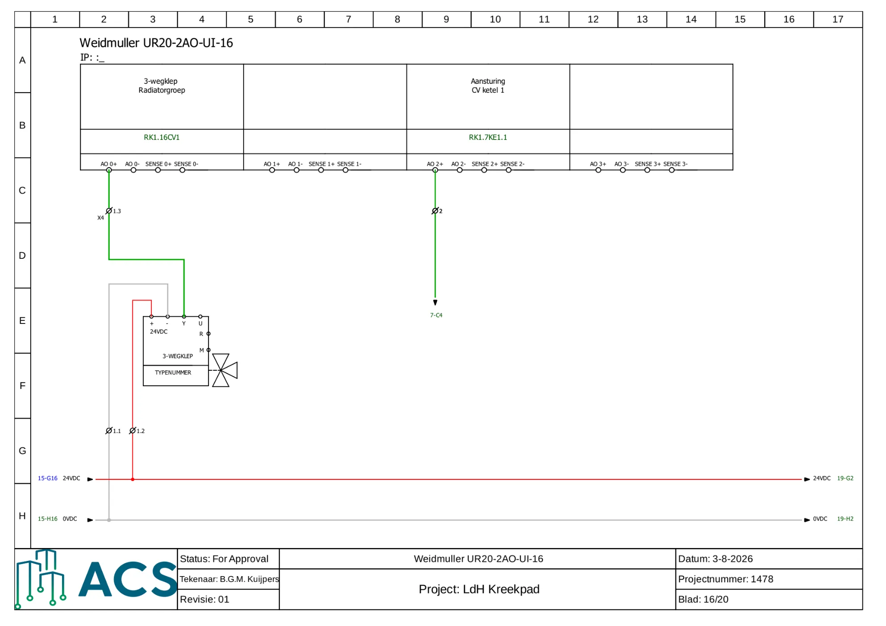
- Kanaal 0: 3-wegklep radiatorgroep (RK1.16CV1). Signaal groen via X4.1.3 naar klemmen "Y" van de klep; voeding 24 VDC (rood, X4.1.2) naar "+", 0 V (grijs, X4.1.1) naar "−". Klepsymbool met klemmen +, −, Y, U, R, M.
- Kanaal 2: aansturing CV-ketel 1 (RK1.7KE1.1), groen, via klem 2 naar blad 7 (7-C4).
- Elk AO-kanaal heeft AO+, AO−, SENSE+, SENSE−.
- Les: klep krijgt drie draden: 24 V, 0 V, stuursignaal Y. Sense is voor spanningscompensatie bij lange kabels.

### 10. Digitale ingangen (blad 36/49, UR20-16DI-P-2W, LDH Kooikerweg RK1)

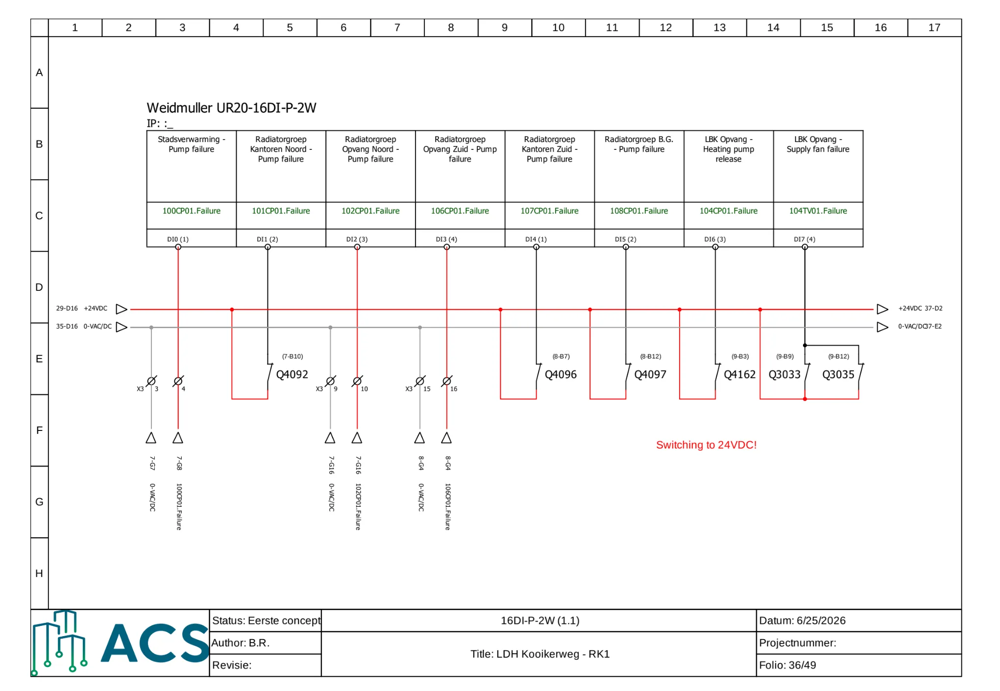
- Acht kanalen met procescode: DI0 stadsverwarming pump failure (100CP01.Failure), DI1 radiatorgroep kantoren noord (101CP01), DI2 opvang noord (102CP01), DI3 opvang zuid (106CP01), DI4 kantoren zuid (107CP01), DI5 radiatorgroep B.G. (108CP01), DI6 LBK opvang heating pump release (104CP01.Failure), DI7 LBK opvang supply fan failure (104TV01.Failure).
- Voeding +24 VDC (rood) en 0-VAC/DC (grijs) lopen als twee lijnen over het blad. Een deel van de ingangen wordt met schakelcontacten Q4092, Q4096, Q4097, Q4162, Q3033, Q3035 gevoed. Deze staan op andere bladen (7-B10, 8-B7, 8-B12, 9-B3, 9-B9, 9-B12). Rode tekst: "Switching to 24VDC!".
- Een aantal storingsmeldingen komt rechtstreeks van het veld via klemmen X3.3/3.4, X3.9/3.10, X3.15/3.16 (met 0 V en signaal), met verwijzing naar bladen 7 en 8.
- Les: de 24 VDC wordt via een potentiaalvrij contact (storingscontact van de pomp of relais) naar de ingang geschakeld. Zonder contact dicht = geen 24 V op de ingang. Ingang "P" schakelt op plus.

### 11. Relaisuitgangen (blad 47/49, UR20-4RO-CO-255, 230 VAC 5 A)

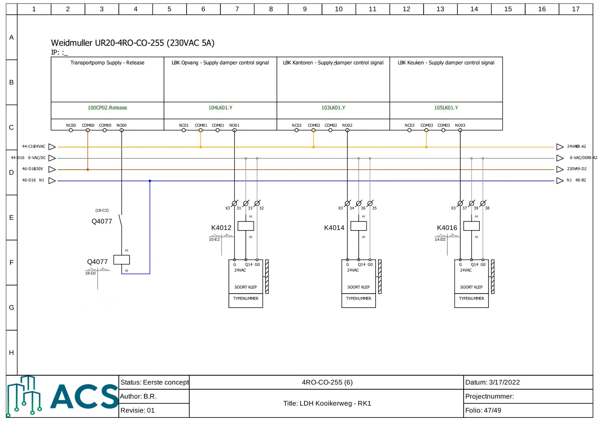
- Vier potentiaalvrije wisselcontacten (NC, COM, COM, NO per kanaal).
- Kanaal 0: transportpomp supply release (100CP02.Release): COM aan 230 V (bruin), NO stuurt spoel Q4077 aan (A1/A2, A2 naar N1 blauw). Het contact van Q4077 staat elders (18-C2); onder de spoel de contactspiegel "18-D2".
- Kanalen 1 t/m 3: LBK-kleppen (104LK01.Y opvang, 103LK01.Y kantoren, 105LK01.Y keuken). COM aan 24 VAC (oranje), NO via klemmen X3.31/33/32, X3.34/36/35, X3.37/39/38 naar de klep (G = 24 VAC, Q14 = signaal, G0 = 0 V). Daarbij tussenrelais K4012, K4014, K4016 met contactspiegel (10-E2 en 14-D2 verwijzen naar het blad waar de contacten zitten; tekening toont ook "soort klep, typenummer" als sjabloon).
- Les: een relaisuitgang is een schakelaar, geen spanning: de spanning die je schakelt moet je zelf op COM zetten (230 V of 24 V). Let op gemengde spanningen op één kaart; daarom is de DO-kaart op blad 10 apart gemarkeerd.

### 12. Het relais zelf (kruisverwijzing, schermafbeeldingen uit de les)

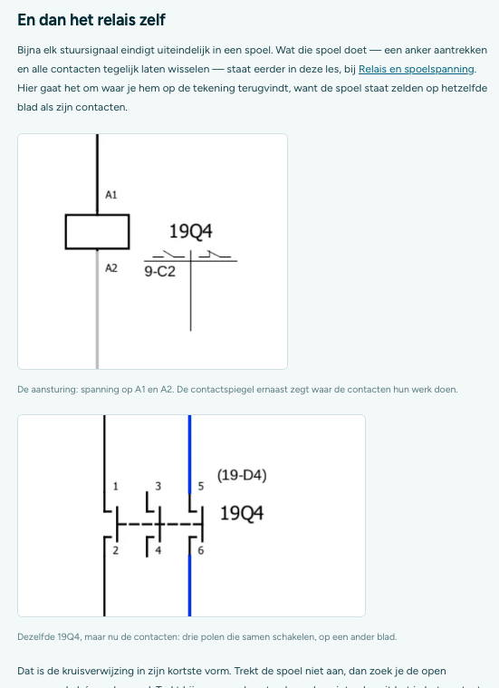
- Spoel 19Q4 met A1 (boven) en A2 (onder), contactspiegel ernaast met "9-C2": daar staan de contacten (blad 9, vak C2).
- Contactgedeelte van dezelfde 19Q4: drie polen (1-2, 3-4, 5-6) die samen schakelen, met de verwijzing "(19-D4)" naar de spoel (blad 19, vak D4). Blauwe lijn = nulleider.
- Les: spoel en contacten staan zelden op hetzelfde blad. Kruisverwijzing in twee richtingen: onder de spoel de contacten, bij de contacten de spoel. Trekt de spoel niet aan, zoek dan de open voorwaarde vóór A1/A2.

### Klemconventie in de ACS-bladen (afgeleid uit blad 10, 15 en 16)
Per veldapparaat gebruikt ACS een klemgroep met drie klemmen: .1 = 0 V (grijs), .2 = +24 V (rood), .3 = signaal (groen). Voorbeeld: Intesis op X3.1/3.2/3.3, klep op X4.1.1/1.2/1.3. Controleer dit op het echte project; het is een patroon uit deze voorbeelden, geen regel uit de cursus.

## Zie ook
Techniek 04 (signalen), Techniek 06 (adres/datapunt), Veldwerk 03.
