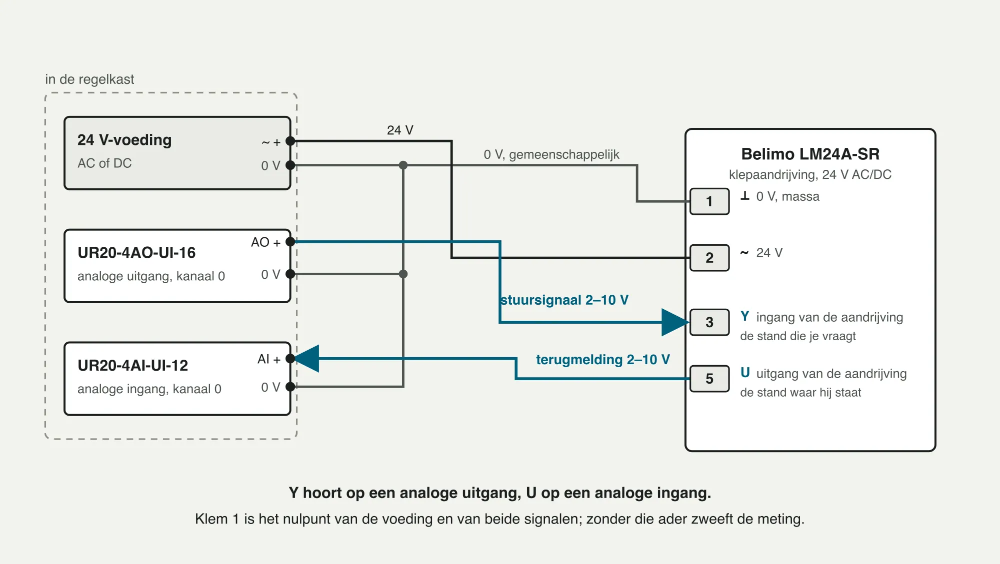
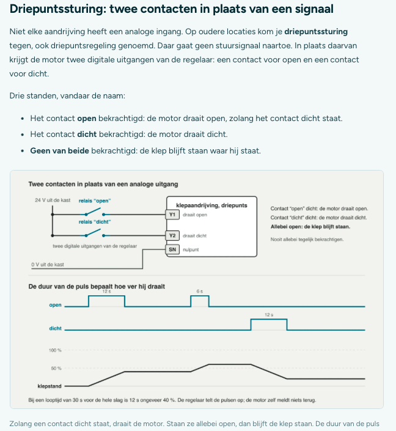
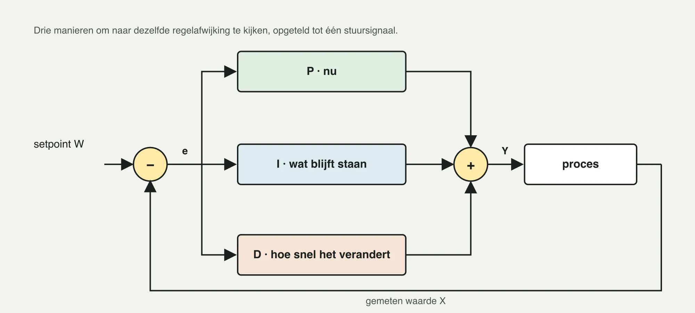
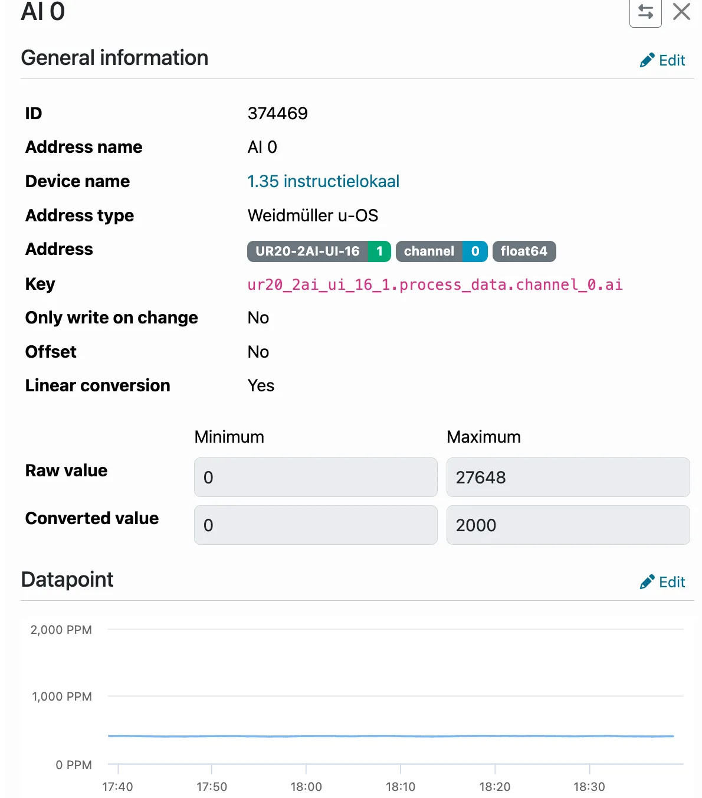
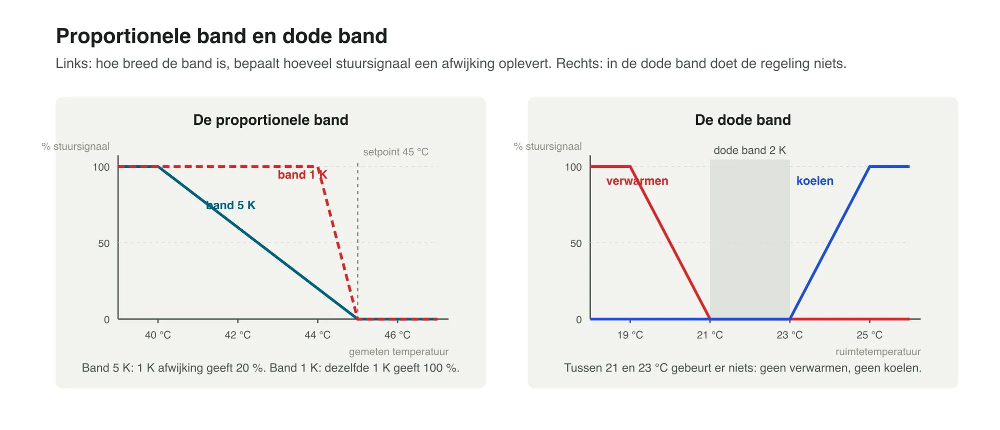

# Techniek 04 — Basis regeltechniek

Module: Techniek (Techniekbasis) · Les 4 van 7 · Bron: ACS Academy (Climatics cursus), gelezen 27-10-2026 · Status: samenvatting in eigen woorden (zonder praktijkopdracht, zelftoets en toets)
Voorkennis: Techniek 01, 03
Volgende les: Techniek 05 — De HVAC-installatie

Trefwoorden: afbeeldingen, Belimo aansluitschema, klem 1 3 5, driepunt tijdlijn, 27648, UR20-2AI-UI-16, BMS, EMS, EBS, SRI, sturen, regelen, W X Y Z, regelafwijking, feedback, feedforward, PID, proportionele band, dode band, 0–10 V, 2–10 V, 4–20 mA, levend nulpunt, driepuntssturing, looptijd, lineaire conversie, Ni1000 Siemens vs DIN, UR20, AI AO DI DO
Beantwoordt vragen als: Wat doen P, I en D? Wat is een proportionele band of dode band? Waarom 2–10 V? Hoe reken ik 0–10 V om naar een waarde? Hoe sluit ik een Belimo LM24A aan? Wat is driepuntssturing? Welke UR20-kaart voor welk signaal? Waarom pendelt een kring?

---

- Gebouwbeheersysteem (BMS) = EMS (sturen op verbruik) + EBS (meten en registreren). SRI (Smart Readiness Indicator, EPBD): 9 domeinen × 7 criteria, klasse G tot A; regeltechniek telt dubbel (eigen domein plus invloed op de andere acht). Nog in beweging, evaluatie 2026.
- Sturen = open keten, regelen = gesloten keten met terugkoppeling. W setpoint, X gemeten waarde, Y stuursignaal, Z verstoring; e = W − X. Feedforward (voorwaartskoppeling, bijv. weersafhankelijke regeling) staat nooit alleen. Een verkeerd meetende voeler geeft geen storing maar een netjes foute installatie.
- PID: P = hoe groot is de fout, I = hoe lang al (maakt nauwkeurig, te snel = pendelen), D = hoe snel verandert het (zelden gebruikt, versterkt ruis, in Climatics meestal 0). Hoge versterking → slingeren; grote dode tijd → rustiger instellen; alleen P → blijvende afwijking.
- Proportionele band (Xp) is omgekeerd aan versterking: smal = scherp. Dode band voorkomt dat verwarmen en koelen elkaar bestrijden (bijv. 21 / 23 °C).
- Signaalsoorten: weerstand (Ni1000/Pt1000), 0–10 V in/uit, 4–20 mA, digitaal in/uit, databus. 2–10 V of 4–20 mA heeft een "levend nulpunt": 0 V = kabelbreuk, niet 0 %.
- Klepaandrijving (Belimo LM24A-SR): klem 1 ⊥ (0 V), 2 ~ (24 V), 3 Y (stuursignaal, naar AO), 5 U (terugmelding, naar AI). Vanuit de regelaar gezien: wat binnenkomt is ingang (AI/DI), wat naar buiten gaat uitgang (AO/DO). Driepuntssturing: twee digitale uitgangen (open/dicht), regelaar telt pulsen op basis van looptijd en stuurt periodiek tegen de eindstop om te synchroniseren; valkuilen: aders verwisseld, verkeerde looptijd, beide contacten tegelijk.
- Omrekenen: waarde = ondergrens + (signaal / bereik) × (bovengrens − ondergrens); bij 2–10 V deel door 8 V na aftrek van 2 V. In Climatics "linear conversion", bijvoorbeeld ruwe 0–27648 voor 0–2000 ppm; offset corrigeert de voeler zelf.
- Weidmüller UR20: kopstation + kaarten. UR20-8AI-RTD-DIAG-2W (voelers), UR20-4AI-UI-12 (0–10 V / 4–20 mA in), UR20-4AO-UI-16 (uit), UR20-8DI-P-2W (digitaal in), UR20-4RO-CO-255 (relais, twee kleppen op driepunt per kaart). Ni1000 bestaat in twee tabellen: Siemens/LG (5000 ppm/K) en DIN 43760 (6180 ppm/K), gelijk bij 0 °C maar ca. 10 K verschil bij 60 °C. Stel het voelertype per kanaal in.

## Afbeeldingen en schema's (door Jasper aangeleverd, 27-10-2026)

Beschrijvingen in eigen woorden van de vijf belangrijkste afbeeldingen uit de les.

### 1. Belimo LM24A-SR aansluiten (schema)

- Links "in de regelkast": 24 V-voeding (AC of DC, uitgang ~/+ en 0 V), UR20-4AO-UI-16 (analoge uitgang, kanaal 0: AO+ en 0 V) en UR20-4AI-UI-12 (analoge ingang, kanaal 0: AI+ en 0 V). Rechts de klepaandrijving Belimo LM24A-SR (24 V AC/DC).
- Aansluitingen: klem 1 (⊥, 0 V, massa) aan de gemeenschappelijke 0 V; klem 2 (~, 24 V) aan de 24 V van de voeding; klem 3 (Y, ingang van de aandrijving: de stand die je vraagt) aan AO+ als stuursignaal 2–10 V; klem 5 (U, uitgang van de aandrijving: de stand waar hij staat) aan AI+ als terugmelding 2–10 V.
- De 0 V van AO en AI worden aan dezelfde gemeenschappelijke 0 V gehangen als klem 1.
- Onderschrift: Y hoort op een analoge uitgang, U op een analoge ingang. Klem 1 is het nulpunt van de voeding én van beide signalen; zonder die ader zweeft de meting.
- Les: vier draden per klep: 0 V, 24 V, Y (naar AO), U (naar AI). Wordt klem 1 vergeten of losgetrokken, dan krijg je een onzinnige of zwevende terugmelding.

### 2. Driepuntssturing (schema + tijdlijn)

- Aandrijving met Y1 (draait open), Y2 (draait dicht) en SN (nulpunt). Twee relaiscontacten ("open" en "dicht") van twee digitale uitgangen schakelen 24 V uit de kast naar Y1 of Y2; SN gaat naar 0 V uit de kast.
- Regel: contact "open" dicht = motor draait open; contact "dicht" dicht = motor draait dicht; allebei open = klep blijft staan. Nooit allebei tegelijk bekrachtigen.
- Tijdlijn: duur van de puls bepaalt hoever de klep draait. Voorbeeld: puls open 12 s, later 6 s, dan puls dicht 12 s; klepstand loopt op en af naar bijvoorbeeld 40 %, daarna hoger en weer lager.
- Onderschrift: bij een looptijd van 30 s voor de hele slag is 12 s ongeveer 40 %. De regelaar telt de pulsen op; de motor zelf meldt niets terug.
- Les: geen terugmelding, dus de regelaar rekent. Looptijd moet kloppen en de regelaar synchroniseert af en toe tegen de eindstop. Gebruik hiervoor relaisuitgangen (UR20-4RO-CO-255).

### 3. PID in blokschema

- Setpoint W gaat naar een sommatiepunt (−); gemeten waarde X komt terug van het proces. De regelafwijking e = W − X gaat parallel naar drie blokken: P (nu), I (wat blijft staan), D (hoe snel het verandert). De drie worden opgeteld (+) tot één stuursignaal Y naar het proces.
- Titel: "Drie manieren om naar dezelfde regelafwijking te kijken, opgeteld tot één stuursignaal."
- Les: P kijkt naar de fout van dit moment, I naar de opgebouwde fout over tijd, D naar de snelheid van verandering.

### 4. Climatics-datapunt met lineaire conversie (schermafbeelding)

- Datapunt "AI 0", ID 374469, device "1.35 instructielokaal", address type "Weidmüller u-OS", adres: UR20-2AI-UI-16 (1), channel 0, float64. Key: `ur20_2ai_ui_16_1.process_data.channel_0.ai`.
- Instellingen: Only write on change = No; Offset = No; Linear conversion = Yes. Ruwe waarde minimum 0, maximum 27648; geconverteerde waarde minimum 0, maximum 2000. Grafiek in PPM (0–2000), lijn rond ongeveer 400 ppm (CO₂ in het instructielokaal).
- Let op: dit voorbeeld toont kaarttype UR20-2AI-UI-16, terwijl de tekst van de les de kaarten 4AI-UI-12 en 4AO-UI-16 noemt. Neem de typenaam altijd over van de echte hardware.
- Les: 27648 is het ruwe maximum van de analoge kaart (voor 10 V of 20 mA), afgebeeld op de bovengrens van de sensor (2000 ppm). Wat Climatics toont is niet de ruwe waarde maar de omgerekende waarde.

### 5. Proportionele band en dode band (twee grafieken)

- Links: stuursignaal (%) uitgezet tegen gemeten temperatuur, setpoint 45 °C. Band 5 K (blauwe lijn): loopt van 100 % bij 40 °C naar 0 % bij 45 °C; 1 K afwijking geeft 20 %. Band 1 K (rode gestippelde lijn): van 100 % bij 44 °C naar 0 % bij 45 °C; 1 K geeft 100 %.
- Rechts: dode band van 2 K tussen 21 en 23 °C (grijs vlak). Verwarmen (rood) loopt van 100 % bij 19 °C naar 0 % bij 21 °C; koelen (blauw) van 0 % bij 23 °C naar 100 % bij 25 °C. Tussen 21 en 23 °C gebeurt niets.
- Les: smalle band = scherp, grote kans op slingeren; brede band = rustig maar trager. Dode band voorkomt dat verwarmen en koelen elkaar afwisselen.

## Zie ook
Techniek 05, 06, 07, Veldwerk 02 (regelkring instellen), Veldwerk 03 (signaalfouten).
