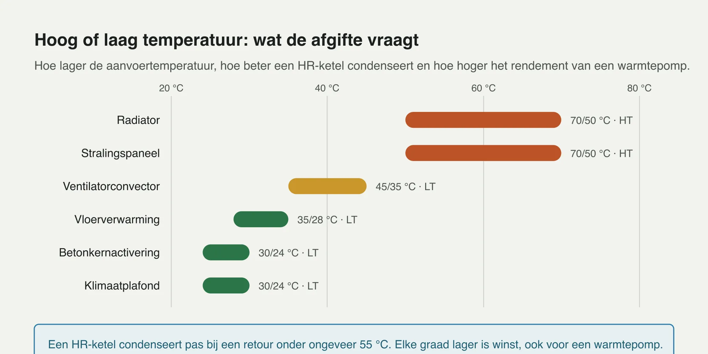
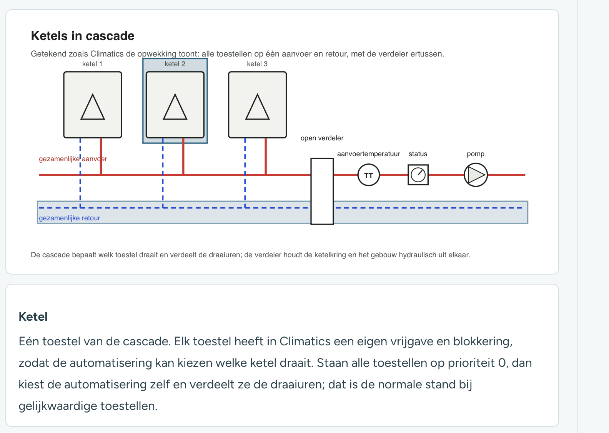
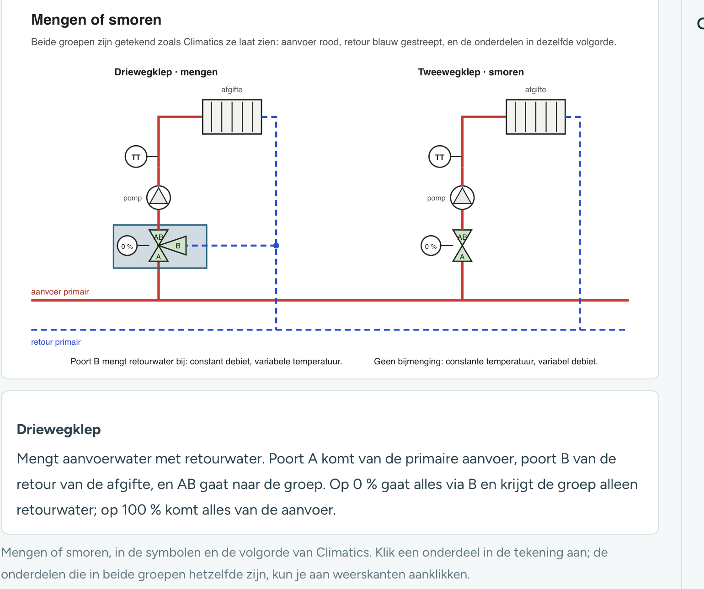
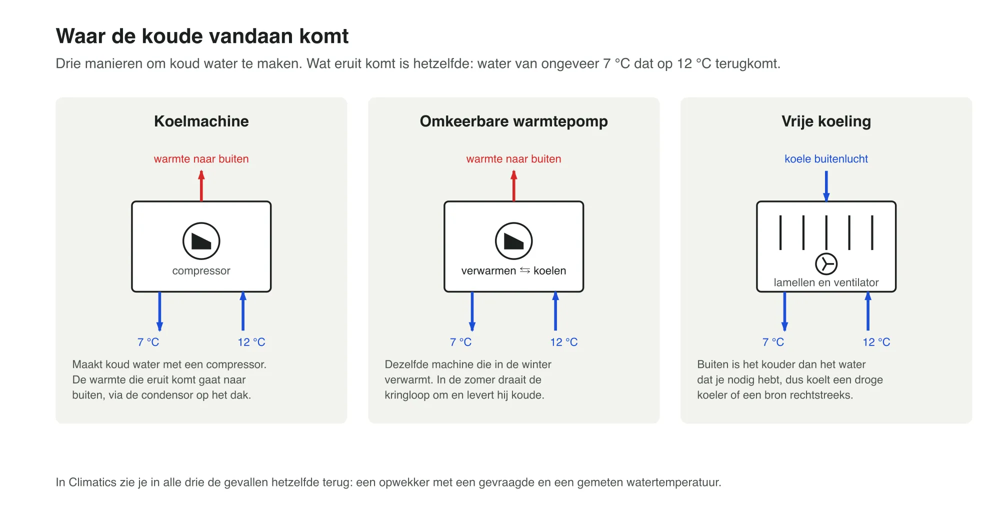
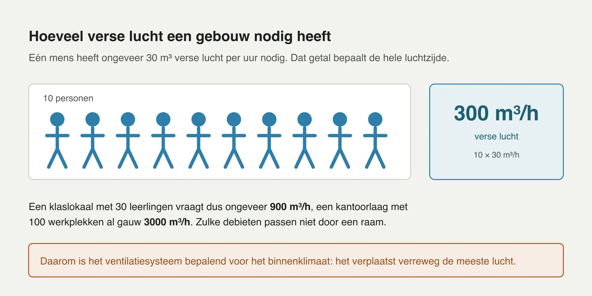
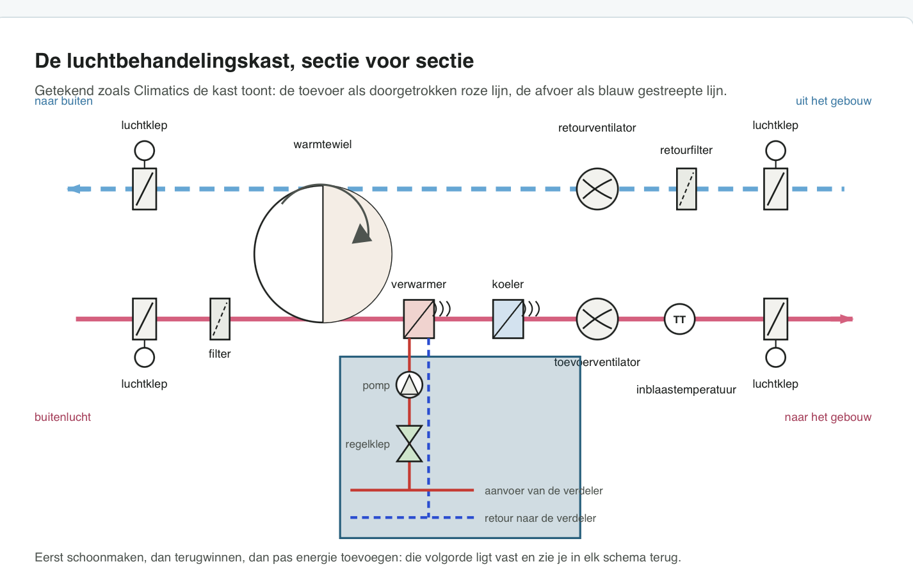
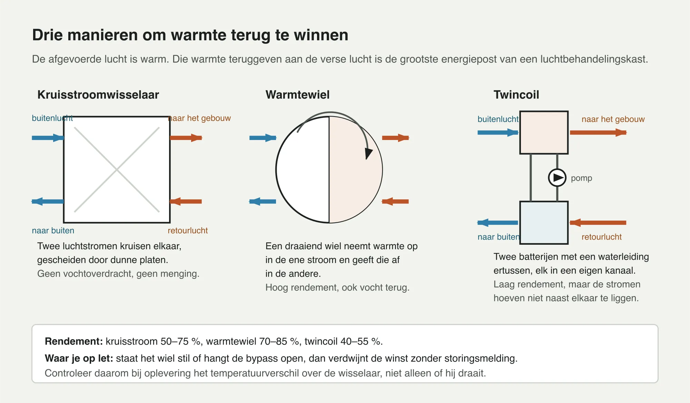
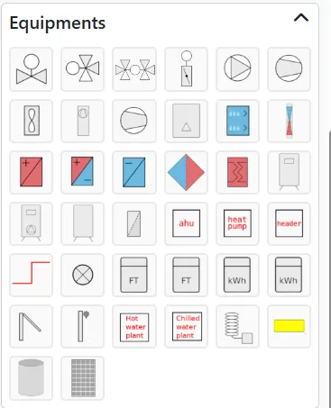

# Techniek 05 — De HVAC-installatie

Module: Techniek (Techniekbasis) · Les 5 van 7 · Bron: ACS Academy (Climatics cursus), gelezen 27-10-2026 · Status: samenvatting in eigen woorden (zonder praktijkopdracht, zelftoets en toets)
Voorkennis: Techniek 04
Volgende les: Techniek 06 — Climatics instellen

Trefwoorden: afbeeldingen, Climatics symbolenpalet, cascade prioriteit 0, 7/12 °C, kruisstroom 50–75 %, warmtewiel 70–85 %, twincoil 40–55 %, HVAC, afgifte, HT/LT, radiator, vloerverwarming, betonkernactivering, klimaatplafond, COP, HR-ketel, cascade, open verdeler, mengen, smoren, driewegklep, ΔT, 1,16, koelen, vrije koeling, dauwpunt, WKO, open bron, gesloten bron, ventilatiesystemen A–D, luchtbehandelingskast, vorstbeveiliging, warmteterugwinning, warmtewiel, kruisstroom, twincoil, batterij, EC-motor
Beantwoordt vragen als: Waarom lage temperatuur verwarmen? Wat is het verschil tussen mengen en smoren? Hoe bereken ik vermogen uit ΔT? Wat zegt een afwijkende ΔT? Welke volgorde zit in een AHU? Hoe werkt vrije koeling? Wat is balans bij een bron? Hoeveel buitenlucht per persoon?

---

- Afgifte: radiator (HT 70/50 tot 45/35), stralingspaneel, ventilatorconvector (45/35 en 7/12), vloerverwarming (35/28, traag), betonkernactivering (ca. 30/24, dagen), klimaatplafond (verwarmen 30, koelen 16 °C, boven dauwpunt houden), all-air.
- Lage temperatuur is zuiniger: HR-ketel condenseert pas bij retour < ca. 55 °C; warmtepomp wint ca. 2–3 % per graad lagere aanvoer. Voorbeeld bij bron 10 °C: COP ≈ 5 bij 35 °C aanvoer, ≈ 3 bij 55 °C. LT-afgifte is voorwaarde voor een warmtepomp.
- Waterzijde: ketels in cascade met open verdeler (let op bijmenging), driewegklep = mengen (debiet constant, temperatuur varieert), tweewegklep = smoren (temperatuur gelijk, debiet varieert). Menggroep per gevel met eigen aanvoertemperatuur. Hoogste verzoek bepaalt de stooktemperatuur.
- ΔT-controle: vermogen (kW) = debiet (m³/h) × ΔT (K) × 1,16. ΔT te klein = te veel debiet, bypass of weinig vraag; ΔT te groot = te weinig debiet (pomp, klep, lucht, filter). Lage retour is dubbel winst.
- Koelen: koelmachine (minimale looptijd, startbegrenzing), omkeerbare warmtepomp, vrije koeling (bron of droge koeler). Koelen heeft baat bij hoge temperatuur (16 °C en hoger maakt vrije koeling mogelijk). Condens: sifon bij AHU en convector, anders boven het dauwpunt blijven. Zomernachtventilatie en vrije koeling zijn regelingen, geen extra apparatuur.
- Bron: open bron (WKO, twee putten, vergunning provincie) of gesloten lussen (melding/vergunning). Balans tussen warmte in en uit is essentieel, ook vergunningseis: meet brontemperaturen en draaiuren bronpompen.
- Ventilatie: ca. 30 m³/h per persoon, CO₂ buiten ca. 420 ppm, goed geventileerd onder 800–950 ppm. Systemen A (natuurlijk), B (mechanische toevoer), C (mechanische afvoer), D (balans, alleen hier toevoer regelen én WTW).
- Luchtbehandelingskast volgorde: klep → filter → warmteterugwinning → verwarmer → koeler → toevoerventilator, retourzijde met klep, filter, ventilator, afvoerklep. Open klep vóór ventilatorstart. Vervang filters op drukval, noteer beginwaarde. WTW is de grootste energiepost (controleer ΔT). Vorstbeveiliging bij ca. 5 °C: kast stopt, klep dicht, pomp start. Inblaasvoeler ver genoeg achter de batterij. Te veel afzuigen = onderdruk. Axiale vs. centrifugale ventilator, EC-motor (0–10 V toerentalwens) vs. asynchroon met frequentieregelaar.
- Warmtewisselaars: platen of pijpen (water–water), batterij (water–lucht), WTW lucht–lucht in drie uitvoeringen: kruisstroom, warmtewiel (neemt ook vocht mee), twincoil.
- Referentie: Programma van Eisen Frisse Scholen (klasse C wettelijk basisniveau, A strengst).

## Afbeeldingen en schema's (door Jasper aangeleverd, 28-10-2026)

Beschrijvingen in eigen woorden. Tekeningen zijn gemaakt "zoals Climatics ze toont": aanvoer rood doorgetrokken, retour blauw gestreept (bij de luchtkast: toevoer roze doorgetrokken, afvoer blauw gestreept).

### 1. Hoog of laag temperatuur: wat de afgifte vraagt (staafdiagram, 20–80 °C)

- Radiator 70/50 °C (HT, ca. 50–70 °C). Stralingspaneel 70/50 °C (HT). Ventilatorconvector 45/35 °C (LT). Vloerverwarming 35/28 °C (LT). Betonkernactivering 30/24 °C (LT). Klimaatplafond 30/24 °C (LT).
- Kader: een HR-ketel condenseert pas bij een retour onder ongeveer 55 °C. Elke graad lager is winst, ook voor een warmtepomp. Hoe lager de aanvoertemperatuur, hoe beter de HR-ketel condenseert en hoe hoger het rendement van de warmtepomp.
- Les: de afgifte bepaalt de benodigde aanvoertemperatuur, en daarmee de opwekker. HT = radiator en stralingspaneel; LT = convector, vloer, beton, plafond.

### 2. Ketels in cascade (Climatics-weergave)

- Drie ketels (ketel 1, 2, 3, driehoeksymbool) elk met een aanvoer (rood) op de gezamenlijke aanvoer en een retour (blauw gestreept) op de gezamenlijke retour. Rechts daarvan een open verdeler, dan aanvoertemperatuur (TT), status (meter) en pomp.
- Onderschrift: de cascade bepaalt welk toestel draait en verdeelt de draaiuren; de verdeler houdt de ketelkring en het gebouw hydraulisch uit elkaar.
- Tekst "Ketel": één toestel van de cascade. Elk toestel heeft in Climatics een eigen vrijgave en blokkering, zodat de automatisering kan kiezen welke ketel draait. Staan alle toestellen op prioriteit 0, dan kiest de automatisering zelf en verdeelt ze de draaiuren; dat is de normale stand bij gelijkwaardige toestellen.
- Les: prioriteit 0 = automatisch kiezen en draaiuren verdelen. Een prioriteit ongelijk aan 0 forceert de volgorde (bijvoorbeeld bij een zuinigere ketel als eerste).

### 3. Mengen of smoren (twee groepen naast elkaar)

- Links: driewegklep, mengen. Klep met poorten A (van primaire aanvoer), B (retour van de afgifte, bijmenging) en AB (naar de groep); daarachter pomp, aanvoertemperatuurvoeler (TT) en afgifte (radiator). Positie-indicatie "0 %" bij de klep.
- Rechts: tweewegklep, smoren. Klep tussen primaire aanvoer en groep, geen bijmenging, zelfde volgorde pomp, TT, afgifte.
- Onderschriften: poort B mengt retourwater bij: constant debiet, variabele temperatuur. Geen bijmenging: constante temperatuur, variabel debiet.
- Tekst "Driewegklep": mengt aanvoerwater met retourwater. A komt van de primaire aanvoer, B van de retour van de afgifte, AB gaat naar de groep. Op 0 % gaat alles via B en krijgt de groep alleen retourwater; op 100 % komt alles van de aanvoer.
- Les: bij 0 % mengklep is de groep gesloten voor primaire warmte (circuit draait rond op eigen retour). In de Climatics-tekening staat de volgorde van de onderdelen vast, zodat je bij elk schema dezelfde route volgt.

### 4. Waar de koude vandaan komt (drie kaders)

- Koelmachine: compressor; warmte naar buiten via condensor op het dak; water 7 °C naar het gebouw, 12 °C terug.
- Omkeerbare warmtepomp: zelfde machine als in de winter, in de zomer draait de kringloop om; warmte naar buiten, 7/12 °C.
- Vrije koeling: lamellen en ventilator (droge koeler) of bron rechtstreeks; koele buitenlucht; 7/12 °C. Buiten is het kouder dan het water dat je nodig hebt.
- Onderschrift: in Climatics zie je in alle drie de gevallen hetzelfde terug: een opwekker met een gevraagde en een gemeten watertemperatuur.
- Les: ongeacht de techniek is de regeling gelijk: gevraagde versus gemeten watertemperatuur. Koelwater is meestal ca. 7 °C aanvoer, 12 °C retour.

### 5. Hoeveel verse lucht een gebouw nodig heeft

- Eén mens heeft ongeveer 30 m³ verse lucht per uur nodig: 10 personen = 300 m³/h (10 × 30). Klaslokaal met 30 leerlingen ≈ 900 m³/h. Kantoorlaag met 100 werkplekken ≈ 3000 m³/h. Zulke debieten passen niet door een raam.
- Conclusie: het ventilatiesysteem is bepalend voor het binnenklimaat, het verplaatst verreweg de meeste lucht.

### 6. De luchtbehandelingskast, sectie voor sectie (Climatics-schema)

- Toevoerlijn (roze, doorgetrokken), van links naar rechts: buitenlucht, luchtklep, filter, warmtewiel, verwarmer, koeler, toevoerventilator, inblaastemperatuur (TT), luchtklep, naar het gebouw.
- Afvoerlijn (blauw gestreept), van rechts naar links: uit het gebouw, luchtklep, retourfilter, retourventilator, warmtewiel, luchtklep, naar buiten.
- Verwarmer en koeler zijn watercoils: onder de verwarmer hangt de waterzijde (regelklep, pomp, aanvoer van de verdeler, retour naar de verdeler), in de tekening uitgelicht.
- Onderschrift: eerst schoonmaken, dan terugwinnen, dan pas energie toevoegen: die volgorde ligt vast en zie je in elk schema terug.
- Let op de nuance: in de les staat de luchtkast met klep, filter, WTW, verwarmer, koeler, ventilator; dit is dezelfde volgorde als hierboven.

### 7. Drie manieren om warmte terug te winnen

- Kruisstroomwisselaar: twee luchtstromen kruisen elkaar, gescheiden door dunne platen. Geen vochtoverdracht, geen menging. Rendement 50–75 %.
- Warmtewiel: draaiend wiel neemt warmte op in de ene stroom en geeft die af in de andere. Hoog rendement, ook vocht terug. Rendement 70–85 %.
- Twincoil: twee batterijen met een waterleiding en pomp ertussen, elk in een eigen kanaal. Laag rendement, maar de luchtstromen hoeven niet naast elkaar te liggen. Rendement 40–55 %.
- Waar je op let: staat het wiel stil of hangt de bypass open, dan verdwijnt de winst zonder storingsmelding. Controleer daarom bij oplevering het temperatuurverschil over de wisselaar, niet alleen of hij draait.
- Les: WTW is de grootste energiepost; stilstaand wiel = onzichtbaar energieverlies.

### 8. Climatics "Equipments"-palet (schermafbeelding)

Paneel met symbolen om een installatieschema in Climatics te tekenen. Leesbaar zijn onder meer: klepsymbolen (twee- en driewegklep), pompsymbool, compressor, ventilator, warmtewisselaar-/batterijsymbolen (rood = verwarmen, blauw = koelen, gecombineerd), warmtewiel, filter, losse blokken met tekst "ahu", "heat pump", "header" (verdeler), "Hot water plant", "Chilled water plant", meterblokken "FT" (flowmeter) en "kWh" (energiemeter), een pulsvormig symbool (puls/schakelaar), lamp, boiler/vat en een zonnepaneelsymbool. Verdere details van de kleine pictogrammen zijn niet betrouwbaar af te leiden uit de schermafbeelding.

## Zie ook
Techniek 06, Veldwerk 02 (waterzijdig/luchtzijdig inregelen).
